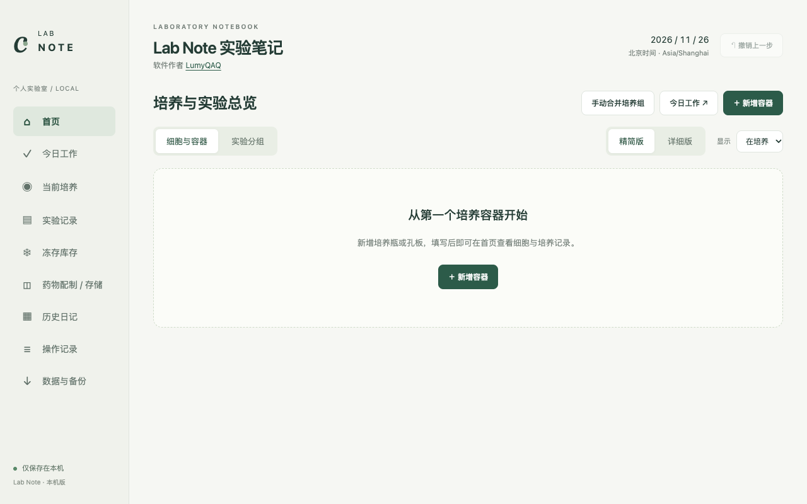

# Lab Note · 实验笔记

软件作者：[LumyQAQ](https://github.com/LumyQAQ) · [官方仓库](https://github.com/LumyQAQ/Lab-Note)

个人使用的细胞培养与实验记录工作台。培养记录按容器和真实孔位组织，可以从某个孔查看培养日龄、操作日志、来源和关联实验。

<!-- repository-only:start -->


[在线分享页](https://lumyqaq.github.io/Lab-Note/) · [下载与签名校验](https://lumyqaq.github.io/Lab-Note/verification.html)

| 系统 | 下载 | 启动 |
| --- | --- | --- |
| Windows 10 / 11 x64 | [1.6.0-preview.1 预览版 ZIP](https://github.com/LumyQAQ/Lab-Note/releases/download/v1.6.0-preview.1/Lab-Note-1.6.0-preview.1-Windows-x64.zip) | 全部解压后双击 `Start-Lab-Note.cmd`，已附 Python |
| macOS | [1.6.0 正式版 ZIP](docs/downloads/lab-note-v1.6.0.zip) | 安装 Python 3.9+，双击「启动实验日记.command」 |

## 本次更新

电脑端可选择通过局域网或 Tailscale 与手机、平板配对。移动端新增主屏幕应用、五键底栏、更多菜单和断网提示，深色模式改善孔位与整组/单孔切换的对比度。

## Windows 本机预览版

双击 `Check-Lab-Note.cmd` 可检查解压后的启动入口、空白数据库和备份。

在解压目录的 PowerShell 中运行：

```powershell
.\Start-Lab-Note.cmd -h
.\Start-Lab-Note.cmd --status
.\Start-Lab-Note.cmd --port 8890
```

默认优先使用 8875，端口冲突时自动改用空闲端口。要切换运行中服务的端口，先执行 `Stop-Lab-Note.cmd`。记录和日志位于 `%LOCALAPPDATA%\Lab Note`。可双击 `Check-Lab-Note.cmd` 用临时库自检。

主分支包含两平台的共用源码。Windows 预览版附件见 [v1.6.0-preview.1](https://github.com/LumyQAQ/Lab-Note/releases/tag/v1.6.0-preview.1)。
<!-- repository-only:end -->

[软件署名及发布校验](AUTHORS.md)

## macOS 本机运行

主机需要 macOS 和 Python 3.9 或更新版本。程序使用 Python 标准库和 SQLite。

1. 下载并解压本地版 ZIP，或下载整个仓库。
2. 双击根目录的 **启动实验日记.command**。也可以在仓库或解压目录中运行下面的命令。

   ```sh
   python3 app/launch.py
   ```

3. 启动器会打开浏览器并显示实际使用的本机地址。首次打开是空白记录，点击「当前培养 → 新增容器」开始填写。

分享版默认把数据保存在 `~/Library/Application Support/Culture Notes Share/`。默认仅监听本机地址 127.0.0.1，优先使用 8875，端口被占用时会自动选择空闲端口，可以与使用 8765 的桌面版本分别运行。

## 手机与平板访问

1. 在电脑上启动工作台，打开「设备」控制中心，选择本机局域网地址或已连接的 Tailscale 地址。跨网访问时，两端需要加入同一个可互访的 Tailscale 网络。
2. 开启 HTTPS 共享后，按控制中心说明将本工作台的公开 CA 证书传到自己的移动设备并信任。在手机或平板上打开页面给出的 HTTPS 地址，用配对码登记设备。
3. 已配对设备可以查看和编辑电脑上的同一份记录。可在移动浏览器中添加到主屏幕，使用底部导航。断网时需要重新连接电脑才能读取或保存记录。
4. 可在电脑端撤销某台设备或停止共享。希望电脑重启并再次打开工作台后自动恢复共享时，在控制中心开启自动恢复。每份工作台单独生成证书与配对凭据。

## 可以记录什么

| 场景 | 功能 |
| --- | --- |
| 每日培养 | 标记容器和孔位、记录 Day 0、培养基、计数、换液或半换液，核对后仍可编辑 |
| 传代与扩孔 | 保存来源到目标孔的对应关系，支持一份来源分到多个条件组 |
| 实验记录 | 流式、Western Blot / 蛋白提取与 BCA、PCR / qPCR、ELISA、发光检测及通用处理观察，可关联细胞来源和原始文件索引 |
| 冻存库存 | 建立设备、架、盒和格位，定位冻存批次，登记移位、取出、弃置和污染复核 |
| 配制与库存 | 登记药物和试剂的配制、分装与存储 |
| 历史追溯 | 查询追加操作与快照，撤销最近变更，导出日记、CSV 和数据库备份 |

服务按北京时间在 22:00 留存每日快照。Mac 需开机并运行服务；在「数据与备份」可手动下载完整备份。程序只分发空白表单，首页配图取自新建的空白工作台；通用版保留观察记录和来源关联，课题专用的方法及计算模板留在原工作台。

## 文件与验证

- `app/` 包含可运行程序和本地网页。
<!-- repository-only:start -->
- `docs/` 包含 GitHub Pages 展示页、空白孔板模板及下载包。双击 `docs/index.html` 可离线预览。
<!-- repository-only:end -->
- `tests/` 使用独立临时目录核验空白启动、历史初始状态、本机访问限制和网页资源。

```sh
python3 -m unittest discover -s tests -v
```

## 检查与安装更新

打开「数据与备份 → 版本与更新」可查看已安装版本和 GitHub Release 说明。联网检查只读取官方仓库的发行信息，断网时仍可正常记录。

从 1.4.0 首次升级，请先下载备份，停止旧服务，再解压新版到新目录并启动。从 1.5.0 起，macOS 的独立解压版可双击包内的「更新培养工作台.command」升级到后续正式版。脚本先验证下载包签名、备份数据库，再替换程序。若使用了自定义数据目录，更新脚本也需传入相同的 `--data-dir`。若同一程序同时服务多个数据目录，请先停止其他实例。Windows 预览版通过此页检查新版本，下载后停止旧版、解压并运行新版。

## 备份与恢复

从旧版升级前，可在旧版的「数据与备份」下载 ZIP 并留存。1.6.0 可以读取旧库。写入压缩历史后，恢复到 1.4.0 需要使用升级前备份。

在「数据与备份」下载 ZIP。解压后，可在解压目录运行 `shasum -a 256 -c original-file.sha256` 核对数据库。将 `culture.sqlite3` 放到单独的恢复目录，用 `python3 app/server.py --data-dir "恢复目录" --port 8890` 打开核验。
